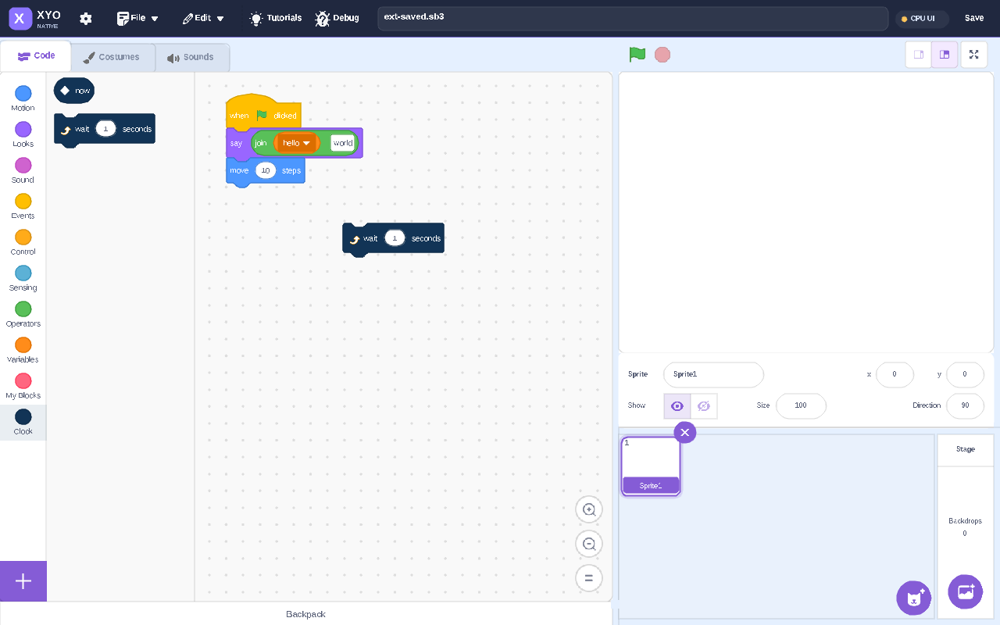
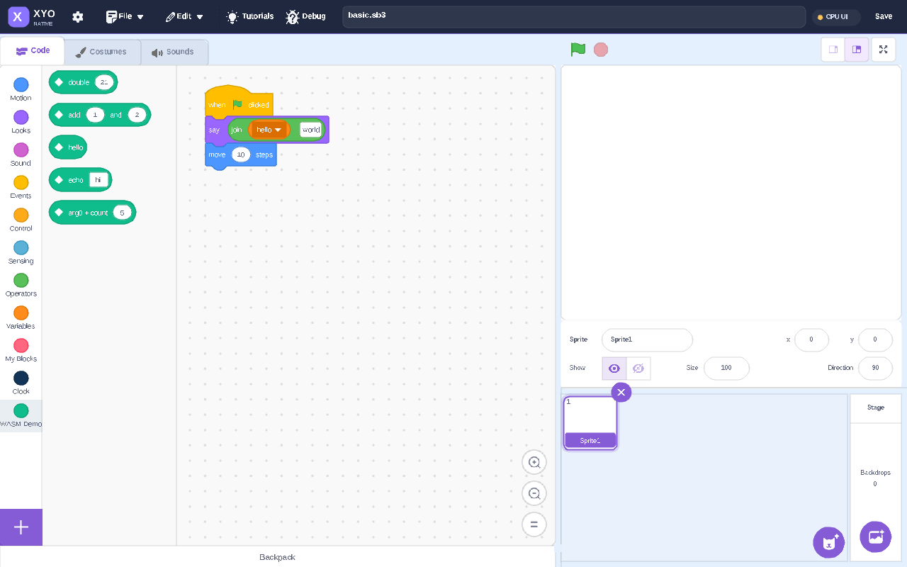

# 自作拡張機構の設計（提案）

状態: 設計提案 / 2026-11-12
対象: xyo-cpp に「ユーザーが自作した拡張ブロック」を持ち込めるようにする。

## 0. 結論（TL;DR）

- **マニフェスト（データ）とプロバイダ（実装）を分離**する。エディタ・ローダ・
  deps・保存はマニフェストだけを見る。
- **`PrimFn` のシグネチャは変えない**。`BlockUtility` に
  `op` と `primitiveContext` を足し、`Runtime` が opcode ごとのコンテキストを
  配る。これで JIT / AOT / インタプリタの全経路が同じ拡張インスタンスを見る。
- **第三者の拡張は WASM を第一級**にする（自分の線形メモリ + import allowlist）。
  xyo のメモリは共有しない。ブラウザは `WebAssembly`、native は WAMR/wasm3。
- **TurboWarp 互換が要るなら JS を別プロバイダ**に足す（QuickJS）。
  `.so` / LLVM bitcode は信頼済みの高速枠に限定する。
- **Phase 0/1、ネイティブ WASM（2a）、Emscripten/Node WASM（2b）は実装済み**。
  ブラウザ UI からの拡張ファイル読み込み、gas 制限、JS プロバイダは未着手。
  §11 参照。

## 1. 目的と非目的

### 目的

- コアを再ビルドせずに、拡張ブロック（スタック / レポータ / Boolean / ハット /
  メニュー）を追加できる。
- 同じ拡張を **native**（`xyo run` / `xyo play` / エディタ）と **ブラウザ WASM**
  の両方で動かせる。
- 拡張が無い環境でも sb3 は開ける（ブロックは保持し、実行時は no-op + 警告）。
- 拡張の有無でプロジェクトの意味論を変えない。既存の JIT / AOT / deps /
  保存形式を壊さない。

### 非目的（初期スコープ外）

- サンドボックス無しのネイティブ拡張を安全に実行すること。`.so` / LLVM bitcode は
  「信頼済み」専用とする。
- TurboWarp の sandboxed（worker）拡張、DOM 依存拡張、WASM の WASI。
- 拡張マーケットプレイスや自動アップデート。

## 2. 現状

### 2.1 実行系はほぼ準備できている

- プリミティブは `Runtime::registerPrimitive(opcode, PrimFn)` で登録する
  （`src/engine/runtime.hpp`）。`PrimFn` は
  `Value (*)(const ArgValues&, BlockUtility&)`（`src/model/blocks.hpp`）。
- `BlockCached` はロード時に `Runtime::getOpcodeFunction(opcode)` を引いて
  `blockFunction` に束縛する（`src/model/blocks.cpp`）。
- JIT は未最適化のスタックブロックを `emitCompat` で汎用呼び出しし
  （`src/jit/codegen.cpp`）、レポータを `xyo_rt_reporter` でインタプリタに
  戻して評価する（`src/jit/rt.cpp`）。`xyo_rt_compat` は `STATUS_YIELD` /
  `STATUS_PROMISE_WAIT` も処理する。
- AOT も `BlockCached*` を slot 経由で実行時に解決するため、登録済みの
  プリミティブなら同じ経路で動く。
- deps は未登録 op を `unknown`（= そのスレッドは逐次）として扱う
  （`src/engine/deps.cpp`）。安全側の既定になっている。

つまり「登録さえすれば実行できる」。足りないのは **登録を外から行う手段** と
**メタデータ（ブロック定義）**、そして **有効化・編集・保存** である。

### 2.2 足りないもの

| 領域 | 現状 | 必要なこと |
|---|---|---|
| 登録 | `registerCoreBlocks` に C++ で直書き | 実行時レジストリ + マニフェスト |
| 状態 | `PrimFn` にコンテキストが無い | 拡張インスタンスへのポインタ |
| ブロック定義 | `src/blockly/catalog.hpp` の静的配列 | 実行時カタログ（stable な storage） |
| ロード | `extensions` は読むだけ。`extensionURLs` 未読 | id → 拡張の解決、欠落時の警告 |
| 保存 | `extensionStorage` を書かない（モデルにはある） | global / target の storage を往復 |
| deps | 未登録 = unknown | マニフェストの access 宣言 |
| エディタ | Add Extension は pen/music 固定 | インストール済み一覧 + ファイル読み込み |
| 配布 | 無し | `.xyoext` パッケージ + 検証 |

## 3. 設計

### 3.1 全体像

```
project.sb3 (extensions: ["myext"])
        │
        ▼
  manifest.json ── blocks / args / hats / access / permissions
        │
        ├─ NativeStatic provider  （組み込み、C++）
        ├─ Wasm provider          （native: WAMR/wasm3 / browser: WebAssembly）
        ├─ Js provider            （QuickJS、TurboWarp 互換。任意）
        └─ Native provider        （.so / .bc、信頼済みのみ。任意）
```

中心は **マニフェスト（データ）** と **プロバイダ（実装）** の分離である。
エディタ・ローダ・deps・保存はマニフェストだけを見る。プロバイダは
「opcode → PrimFn」を提供するだけに保つ。

### 3.2 マニフェスト

```json
{
  "schema": 1,
  "id": "myext",
  "name": "My Extension",
  "version": "1.0.0",
  "color": "#0FBD8C",
  "icon": "icon.svg",
  "provider": "wasm",
  "abi": 1,
  "permissions": ["network"],
  "blocks": [
    {
      "opcode": "myext_turn",
      "label": "turn %1 degrees",
      "shape": "stack",
      "args": [
        {"name": "DEG", "type": "number", "default": "15"}
      ]
    },
    {
      "opcode": "myext_angle",
      "label": "angle",
      "shape": "reporter"
    },
    {
      "opcode": "myext_ready",
      "label": "when ready",
      "shape": "hat",
      "edge": true,
      "restart": false
    },
    {
      "opcode": "myext_menu_mode",
      "label": "mode %1",
      "shape": "reporter",
      "args": [
        {"name": "MODE", "type": "dropdown", "options": ["fast", "safe"]}
      ]
    }
  ],
  "access": {
    "myext_turn":  {"writes": ["target.heading"]},
    "myext_angle": {"reads":  ["target.heading"]},
    "myext_ready": {"reads":  [], "edge": true}
  }
}
```

規約:

- `id` は opcode の prefix（`myext_`）と一致する。`[a-z0-9-]+` のみ。
- opcode はプロセス全体で一意。既存と衝突したら登録を拒否する。
- `shape` は `stack | reporter | boolean | hat | end`。
- `args[].type` は `number | string | boolean | angle | dropdown`。
  `dropdown` は `options` が必須（文字列、または `{label, value}`）。
- `access` は deps 用。未宣言は `unknown`（逐次・保守的）でよい。
- `permissions` はホスト関数の capability。`network` / `filesystem` /
  `clipboard` など。マニフェストに無い権限の import は実行時に拒否する。

Phase 1 で実装したのは `id` / `name` / `color` / `blocks`（`shape`・`hat`・
`edge`・`restart`・`conditional`・`loop`・`args`）まで。`provider` / `abi` /
`permissions` / `access` / `icon` はパースだけ（または未読）で、動作には
まだ使っていない。

### 3.3 レジストリと PrimFn コンテキスト

`PrimFn` のシグネチャは変えない。代わりに **呼び出し単位のコンテキスト** を
`BlockUtility` に足す。

```cpp
// src/engine/block_utility.hpp
struct BlockCached;
class BlockUtility {
public:
    // ...
    const BlockCached* op = nullptr;   // 現在実行中の op（opcode 用）
    void* primitiveContext = nullptr;  // 拡張インスタンス
};
```

```cpp
// src/model/blocks.hpp
struct BlockCached {
    // ...
    void* primitiveContext = nullptr;
};
```

実行側は 2 箇所だけ:

```cpp
// src/engine/execute.cpp（プリミティブ呼び出しの直前）
g_util.op = opCached;
g_util.primitiveContext = opCached->primitiveContext;
```

```cpp
// src/jit/rt.cpp（xyo_rt_compat）
util.op = op;
util.primitiveContext = op->primitiveContext;
```

登録側は `Runtime` にコンテキストを保持する。

```cpp
bool Runtime::registerPrimitive(const std::string& opcode, PrimFn fn,
                                void* context = nullptr);
void* Runtime::getOpcodeContext(const std::string& opcode) const;
```

`Blocks` の構築時に `self->primitiveContext = runtime->getOpcodeContext(opcode)`
を入れる（`src/model/blocks.cpp`）。これで **JIT / AOT / インタプリタの
すべて** が同じコンテキストを見る。`blockFunction` は非 null のままなので
`definedBlockFunction` や shadow 判定、ブロックカウントも変わらない。

拡張は 1 個の汎用サンクで登録できる。

```cpp
Value extensionThunk(const ArgValues& args, BlockUtility& util) {
    auto* ext = static_cast<ExtensionInstance*>(util.primitiveContext);
    if (!ext || !util.op) return Value::undefined();
    return ext->call(util.op->opcode, args, util);
}
```

`ExtensionInstance` はこうする。

```cpp
class ExtensionInstance {
public:
    virtual ~ExtensionInstance() = default;
    virtual const ExtensionDef& def() const = 0;
    virtual void onLoad(Runtime&) {}
    virtual void onUnload() {}
    virtual Value call(const std::string& opcode,
                       const ArgValues& args, BlockUtility& util) = 0;
};
```

`registerExtension` は次を行う。

1. id / opcode の重複検査。
2. 各ブロック opcode に `extensionThunk` と `instance` を登録。
3. ハットなら `registerHat(opcode, meta)`。
4. C-block なら `registerFlowing`（`conditional` / `loop`）または
   プリミティブ内で `util.startBranch`。
5. マニフェストの access を deps に渡す。

### 3.4 プロバイダ

| プロバイダ | 用途 | 実装 |
|---|---|---|
| NativeStatic | 組み込み（pen/music/translate/demo） | 直接 `ExtensionInstance` |
| Wasm | 第三者の配布物。本命 | §5 |
| Js | TurboWarp 互換が必要なとき | QuickJS + `Scratch` シム |
| Native | 信頼済みの高速拡張 | `.so` / `.bc`。既定 off |

同じマニフェストで複数プロバイダを持てるようにする。

```json
"providers": {
  "wasm": {"file": "ext.wasm"},
  "native": {"linux-x86_64": "libmyext.so"}
}
```

ホストは「native があれば優先、無ければ wasm」と選ぶ。フォールバックしても
ブロック定義は同じなので、プロジェクトの見た目は変わらない。

## 4. 実行時の統合

### 4.1 ハット

- `edge: true` は `registerHat(..., edgeActivated=true)` にする。`Runtime::step`
  が毎フレーム `startHats` を呼ぶ既存経路に乗る（`src/engine/runtime.cpp`）。
- `restart: true` は `restartExistingThreads` に対応。
- イベント駆動のハットは、拡張側からホストの `startHats` を呼ぶ API を用意する。

### 4.2 メニュー

- 静的な選択肢はマニフェストの `menu` 配列から `BlockDef` を作る。
- 動的メニューはプロバイダの `menu(opcode)` を呼ぶ。エディタはフライアウト
  構築時に呼ぶため、エディタにもプロバイダが必要になる。初期は静的のみ。

### 4.3 非同期と yield

- インタプリタ / JIT compat は `STATUS_YIELD` / `STATUS_PROMISE_WAIT` を
  すでに処理する。拡張は native なら `util.yield()` / `util.promiseResolveNextTick()`、
  WASM なら `call` の戻り値で表現する。
- WASM は関数の途中中断ができないため、`DONE / YIELD / PENDING` の
  協調方式にする（§5.2）。

### 4.4 並列性（deps）

- マニフェストの `access` から `OpRule` を作る。未宣言は `unknown`。
- WASM のようにインスタンスがスレッドセーフでないプロバイダは、その拡張の
  全ブロックを `mainThread` にする。並列性は落ちるが安全。
- `minify --aggressive` は同じ解析を使うので、宣言があると精度が上がる
  （未宣言でも保守的に残る）。

### 4.5 保存とロード

- `loadSb3` の後、`extensions` の各 id を `runtime.activateExtension(id)` する。
- 見つからない id は `missingExtensions` に積む。既定は警告 + no-op。
  `--strict-extensions` でロード失敗にする。
- `extensionURLs`（id → URL）を読む。既定では URL を自動取得しない。
  インストール済み拡張の id 解決にだけ使う。プロジェクト同梱の拡張は
  `--allow-project-extensions` のときだけ読む。
- `extensionStorage`（project 全体と target）を load/save する。
  現状の `saveSb3` はこれを落とすので、拡張が設定を持つなら必須。
- 保存時の `extensions` 配列は既存の opcode prefix 推定でよいが、
  未使用の拡張 id を落とさないように `extensionURLs` と併せて保持する。

## 5. WASM プロバイダ

### 5.1 パッケージ

```
myext.xyoext/
  manifest.json
  ext.wasm
  icon.svg
  README.md
```

ディレクトリでも zip でもよい。インストール先は
`$XDG_DATA_HOME/xyo/extensions`（Windows は `%APPDATA%/xyo/extensions`）を
既定にし、`--extension <path>` / `XYO_EXTENSION_PATH` で追加する。

### 5.2 ABI

拡張は自分の線形メモリを持つ。**xyo のメモリを import させない。**
これは既存の wasm JIT（生成コードが `env.memory` を import する）とは
意図的に異なる。生成コードは信頼済みだが、外部拡張は信頼しない。

```c
// exports
uint32_t xyo_ext_abi(void);                 // 1
uint32_t xyo_ext_alloc(uint32_t n);
void     xyo_ext_free(uint32_t p);
int32_t  xyo_ext_call(uint32_t op,
                      uint32_t args, uint32_t nargs,
                      uint32_t ret);         // 0=done 1=yield 2=pending <0=error
```

```c
// args / ret は拡張メモリ上の配列
struct XyoArg {
    uint32_t tag;       // 0=undefined 1=number 2=string 3=bool
    double   num;
    uint32_t str_ptr;
    uint32_t str_len;
};
```

`op` はマニフェストの `blocks[].opcode` をロード時に整数 ID へ割り当てたもの。
文字列を毎回渡さない。

### 5.3 ホスト import（allowlist）

```
xyo_arg_count / xyo_arg_tag / xyo_arg_num / xyo_arg_str_copy
xyo_ret_num / xyo_ret_str
xyo_var_get / xyo_var_set / xyo_list_get / xyo_list_set / xyo_list_len
xyo_target_x / xyo_target_y / xyo_target_heading
xyo_broadcast / xyo_start_hat
xyo_random / xyo_timer
xyo_log
xyo_http_get / xyo_http_post        （permission: network）
```

- 生ポインタ（`SStr*` / `Target*` / `Variable*`）は絶対に渡さない。
- 文字列は UTF-8 でコピー。Scratch 内部は UTF-16 なので境界で変換する。
- 返値もコピー。GC のルート管理はホスト側で完結する。

### 5.4 メモリとサンドボックス

- 拡張ごとに独立した `WebAssembly.Memory`。最大ページ数を制限する。
- import は allowlist のみ。WASI は使わない。
- `start` セクションは実行時間を制限する。
- 命令数 / 時間の上限（fuel）を掛けられるエンジンを選ぶ。無い場合、
  `while(1){}` でランタイム全体が止まる。
- ホスト関数は受け取った offset / length を必ず検証する。
- エンジンの脆弱性は更新で追う。信頼できない拡張を多数入れるなら、
  別プロセス実行も選択肢になる（初期スコープ外）。

### 5.5 エンジン

| エンジン | 長所 | 短所 |
|---|---|---|
| wasm3 | MIT、小さい、組み込みやすい | メンテが緩い、メタリングが弱い |
| WAMR | Apache-2.0、活発、AOT/JIT、制限機能 | やや大きい |
| wasmtime | 堅牢、JIT、fuel | 重い（Rust/C++ ツールチェーン） |

**実装は wasm3 0.9.2 を vendored**（`third_party/wasm3`、MIT）。
`XYO_WASM_EXT=ON`（native 既定、Emscripten では自動 OFF）で有効になり、
オフのときは `.wasm` 拡張を「プロバイダ未ビルド」としてスタブへフォールバック
する。wasm3 の gas（`c_m3Limit_GasUnits`）とメモリ上限
（`c_m3Limit_MemoryBytes`）を使い、無限ループは 1 呼び出し内で trap する。

### 5.6 ブラウザ / wasm ビルド

- ブラウザではブラウザの `WebAssembly.instantiate` を使う。エンジンは不要。
- **実装済み**: `src/extensions/wasm_provider_browser.cpp` が `EM_JS` で
  拡張モジュールを instantiate し、引数・戻り値を JS 側でコピーする。
  `xyo_arg_*` / `xyo_log` は JS の closure として提供する。
- 拡張のメモリは xyo のメモリと別。ホスト関数は JS 側でコピーする。
- Asyncify 中の再入を避けるため、ホスト関数は同期・非ブロッキングに保つ。
  非同期は `PENDING` + メインループからの resume にする。
- **gas は無い**。ブラウザの WebAssembly は途中停止できないため、無限ループ
  する拡張は main thread を止める。信頼できない拡張には Worker 等が必要。

### 5.7 制約

- **スレッド**: 1 インスタンスはスレッドセーフでない → `mainThread` 固定。
- **再入**: ホストコールバックが同期実行する API を足すなら、効果キューに
  積むか再入禁止を明記する。
- **yield**: 途中中断不可 → 協調 `YIELD`。
- **性能**: native のインタプリタはタイトなループで 5〜20 倍遅い。
  ホットな拡張は native プロバイダを併売する。
- **デバッグ**: DWARF / source map は努力目標。`.so` よりは難しい。

## 6. エディタ

- `edit::findBlock` を「静的カタログ + 実行時登録」に変える。動的エントリは
  `std::deque<BlockDef>` か `std::unique_ptr` で保持する（`BlockDef*` を
  保持する箇所があるため、`vector` の再確保は禁止）。
- `styleOf` の `st.ext` 判定を「登録済み拡張の prefix か」に変える
  （`src/blockly/layout.cpp`）。ブロック左の 24px アイコンはマニフェストの
  icon か汎用アイコン。
- Add Extension は「インストール済み一覧」と「ファイルから読み込む」。
- 未ロード拡張のブロックは警告色で表示し、実行は no-op。
- メニューは静的配列から `ArgDef` を作る。動的メニューは初期スコープ外。

## 7. セキュリティ

| プロバイダ | 信頼モデル | 既定 |
|---|---|---|
| NativeStatic | xyo 本体と同じ | 有効 |
| WASM | サンドボックス（import allowlist） | 有効 |
| JS | サンドボックス（QuickJS + 権限） | 任意 |
| `.so` / `.bc` | 任意コード実行 | 明示時のみ |

- プロジェクト内の URL から拡張を自動ロードしない。
- `permissions` に無いホスト関数は import 時点で拒否する。
- ネイティブ拡張は「ユーザーが明示的にインストールしたもの」だけ。
- 拡張の id / opcode 衝突は拒否。上書きは `--allow-extension-override` のみ。

## 8. 段階計画

### Phase 0 — レジストリの背骨（実装ファイルは既存の未コミット差分を避ける）

- `BlockUtility::{op, primitiveContext}`、`BlockCached::primitiveContext`。
- `Runtime::registerPrimitive(op, fn, ctx)` と `getOpcodeContext`。
- `src/extensions/extension.hpp|.cpp` の `ExtensionDef` / `ExtensionInstance` /
  `ExtensionRegistry`。
- `src/extensions/demo.cpp`（`demo_double` レポータ + `demo_next` で状態を確認）。
- 単体テスト（interp / JIT eager / AOT で同じ結果）。
- 既存テストが全て通ること。拡張未使用時の挙動は不変。

### Phase 1 — マニフェストとエディタ（一部完了）

実装済み:

- JSON マニフェストのロードと検証（`src/extensions/manifest.*`）。
  `id` / `name` / `color` / `blocks` / `shape` / `args` / `hat` / `edge` /
  `restart` / `conditional` / `loop`。
- `XYO_EXTENSION_PATH` のスキャン（ディレクトリ / `manifest.json` /
  1 階層下の `<name>/manifest.json`）。`XYO_EXTENSION_DEBUG=1` でログ。
- `ManifestStubExtension`（no-op）として Runtime に登録。ブロックは
  compat 経路に乗り、JIT でもコンパイルできる。
- 動的カタログ（`src/blockly/dynamic_catalog.*`）。`findBlock` フック、
  `styleOf` の ext 判定、ツールボックスのカテゴリ。
- エディタでフライアウト表示 → ドラッグ → 保存 → 再読込。
- `extensionStorage`（global / target）と `extensionURLs` の load/save。

未着手:

- Add Extension の永続状態と UI（現状はインストール済みを常時表示）。
- `--extension <path>` の明示指定、アイコン、未ロード警告。
- deps の access 反映（現状は unknown = 逐次）。
- 実プロバイダ（WASM / JS / native）。現状のブロックは no-op。

サンプル: `examples/extensions/clock/manifest.json`。

```sh
XYO_EXTENSION_PATH=examples/extensions ./build/xyo edit tests/fixtures/basic.sb3
```



### Phase 2 — WASM（native / Emscripten Node 実装済み）

実装済み:

- wasm3 の vendoring と `XYO_WASM_EXT` オプション。
- `src/extensions/wasm_provider.*` の ABI（`xyo_ext_abi` / `alloc` / `call`）、
  `xyo_arg_*` / `xyo_log` のホスト import、型付き引数マーシャリング。
- メモリ 64 MiB / gas 1 億（呼び出しごとに再アーム）。
- `examples/extensions/wasm_demo`（double / add / hello）と
  `tests/fixtures/extensions/spin`（無限ループの gas テスト）。
- `tests/extensions/extensions_unit.cpp` で interp / JIT eager の両方を検証。

実装済み（Emscripten / Node）:

- `src/extensions/wasm_provider_browser.cpp`（`EM_JS` + ブラウザ `WebAssembly`）。
- xyo とは別の拡張メモリ、JS 側の引数・戻り値コピー、`xyo_arg_*` / `xyo_log`。
- `tests/wasm/extensions_check.mjs` が headless Emscripten ビルドで
  `wasm_demo.sb3` を実行し `42 / 3 / hello from wasm / 6` を検証。

未着手:

- ブラウザ UI（MEMFS / fetch）からの拡張ファイル読み込み。
- `.xyoext` パッケージ、`xyo ext pack` / `xyo ext new`。
- 非同期（`PENDING` + resume）、ホスト mutation API（変数・broadcast）、
  動的メニュー。
- ブラウザでの gas / タイムアウト（Worker 分離）。
- malformed wasm の fuzz、OOM の明示テスト。

### Phase 3 — 追加プロバイダ

- QuickJS + `Scratch` シム（TurboWarp unsandboxed 互換）。
- `.so` / `.bc` の信頼済み native tier。
- AOT への `.wasm` 埋め込み。

## 9. テスト

- **単体**: レジストリ、id/opcode 衝突、コンテキストが interp / JIT / AOT で
  一致すること、ハットの edge 判定、メニュー解決。
- **E2E**: `demo_*` を含む sb3 を `xyo run` / `xyo test` で実行。
- **WASM**: import allowlist 違反、メモリ上限、fuel 超過、壊れた wasm、
  `start` の暴走、ブラウザでの instantiate。
- **回帰**: 既存の execute 116 件、ctest 6/6、差分 repro 19 件、
  scratch-bench の checksum。

## 10. 未決事項

1. WASM エンジンは WAMR か wasm3 か（配布サイズ / メタリング / メンテ）。
2. 拡張インスタンスはプロセスに 1 個か、ターゲットごとか。
3. 非同期 API の形（`PENDING` + token か、ホスト側 promise か）。
4. 動的メニューを許すか（エディタ側にエンジンが必要）。
5. インストール UI と配布（`.xyoext` の署名 / ハッシュ）。
6. `extensionStorage` のスキーマ（拡張ごとの自由領域か、型付きか）。

## 11. 実装状況（Phase 0/1/2a / 2026-11-12）

### Phase 0 — 実行時の背骨

- `src/extensions/extension.hpp|.cpp`
  - `ExtensionBlockDef` / `ExtensionDef` / `ExtensionInstance`
  - `ExtensionRegistry::add(Runtime&, instance, error)`
  - 共通サンク `extensionPrimitive`
- `src/extensions/demo.hpp|.cpp`
  - `demo_double`（reporter）/ `demo_next`（reporter）/ `demo_set`（stack）
- `src/engine/block_utility.hpp`
  - `BlockUtility::{op, primitiveContext}`
- `src/model/blocks.hpp|.cpp`
  - `BlockCached::primitiveContext` と構築時の束縛
- `src/engine/runtime.hpp`
  - `registerPrimitive(op, fn, ctx)` と `getOpcodeContext`
- `src/engine/execute.cpp`
  - インタプリタのプリミティブ呼び出し前にコンテキストを設定
- `src/jit/rt.cpp`
  - `xyo_rt_compat` でコンテキストを設定（スコープ付きで復元）

### Phase 1 — マニフェストとエディタ

- `src/extensions/manifest.hpp|.cpp`
  - JSON マニフェストのパースと検証
  - `XYO_EXTENSION_PATH` のディレクトリ走査
  - `ManifestStubExtension`（no-op）としての登録
  - `XYO_EXTENSION_DEBUG=1` のログ
- `src/blockly/dynamic_catalog.hpp|.cpp`
  - `ExtensionDef` → `edit::BlockDef` / `CategoryDef` の変換
  - `catalog.hpp` の `findBlock` フック
  - `layout.cpp` の `st.ext` 判定
  - `editor.cpp` のツールボックスへのカテゴリ追加
- `src/load/sb3.cpp` / `src/load/sb3_save.cpp`
  - `extensionStorage`（global / target）と `extensionURLs` の load/save
- `src/shell/main.cpp` / `src/shell/editor.cpp`
  - `run` / `play` / `edit` の起動時に `XYO_EXTENSION_PATH` を登録
- `examples/extensions/clock/manifest.json`
  - reporter / stack + number / dropdown / hat のサンプル

### Phase 2a — ネイティブ WASM

- `third_party/wasm3`（0.9.2、MIT、コアのみ vendored）。
- `src/extensions/wasm_provider.hpp|.cpp`
  - `xyo_ext_abi` / `xyo_ext_alloc` / `xyo_ext_call` の ABI
  - `xyo_arg_count` / `xyo_arg_tag` / `xyo_arg_num` / `xyo_arg_str_copy` /
    `xyo_log` のホスト import
  - 型付き引数マーシャリング（manifest の `number` / `string` / `boolean` /
    `angle` / `dropdown`）
  - メモリ 64 MiB、gas 1 億（呼び出しごとに再アーム）
  - `XYO_WASM_DEBUG=1` で trap を stderr へ
- `examples/extensions/wasm_demo`
  - `wasmdemo_double` / `wasmdemo_add` / `wasmdemo_hello` と `build.sh`
- `tests/fixtures/extensions/spin`
  - 無限ループが gas で trap し、次のブロックへ進むことのテスト



### Phase 2b — Emscripten / Node

- `src/extensions/wasm_provider_browser.cpp`
  - `EM_JS` でブラウザ / Node の `WebAssembly` を利用
  - 拡張は xyo とは別の `WebAssembly.Memory`
  - `xyo_arg_*` / `xyo_log` を JS closure として提供
  - 引数・戻り値は JS 側でコピー
- `tests/fixtures/extensions/wasm_demo.sb3`
  - `wasmdemo_double` / `_add` / `_echo` / `_sumcount` をリストへ追加
- `tests/wasm/extensions_check.mjs`
  - headless Emscripten ビルドで `42 / 3 / hello from wasm / 6` を検証
- ブラウザの WebAssembly には gas が無いため、無限ループは止められない
  （ネイティブの wasm3 だけが gas で trap する）。

### 検証

```sh
cmake -S . -B build
cmake --build build -j4 --target xyo-extensions-unit xyo-cli
ctest --test-dir build -R '^xyo-extensions-unit$' --output-on-failure
# xyo-extensions-unit: 122 checks, 0 failures

SDL_VIDEODRIVER=dummy SDL_AUDIODRIVER=dummy \
  XYO_EXTENSION_PATH=examples/extensions XYO_EDIT_TEST=1 \
  ./build/xyo edit tests/fixtures/basic.sb3
# EDIT-TEST: all checks passed

# Emscripten / Node（headless）
emcmake cmake -B build-wasm-ext -G Ninja \
  -DCMAKE_TOOLCHAIN_FILE=cmake/emscripten.cmake \
  -DCMAKE_BUILD_TYPE=Release -DXYO_SDL2=OFF -DXYO_BUILD_TESTS=OFF
cmake --build build-wasm-ext -j4
node tests/wasm/extensions_check.mjs build-wasm-ext/xyo.js
# PASS
```

エディタの実機確認:

- `XYO_EXTENSION_PATH=examples/extensions XYO_EDIT_CAT=clock` で
  Clock カテゴリが表示され、`now` / `wait %1 seconds` / `mode %1` /
  `when ready` がフライアウトに並ぶ（`docs/extensions-editor.png`）。
- `clock_wait` をワークスペースへドラッグし、`XYO_EDIT_SAVE` で保存した
  sb3 に `clock_wait` と `extensions: ["clock"]` が入ることを確認。
- その sb3 を再読込し、ブロックが同じ色・shape で描画されることを確認。
- `xyo run` で `clock_now` / `clock_wait` を含む sb3 がロードでき、
  `[ext] loaded clock (2 blocks)` が出る（実行は no-op スタブ）。
- WASM 拡張を CLI で実行:
  `XYO_EXTENSION_PATH=examples/extensions ./build/xyo run wasmproj.sb3
  --print-list out --frames 3` → `42` / `3` / `hello from wasm`。
  `--jit=eager` でも同じ。無限ループの `spin_loop` は gas で trap し、
  後続の `set v to 1` が実行される（`tests/fixtures/extensions/spin`）。

`xyo-tests` 全体では `test_danger` の 1 件だけが失敗している。これは
実行中だった scheduler / JIT の mega-dispatch 差分（`stepThread` の
yield 経路）に起因するもので、拡張の変更箇所（コンテキストの受け渡しと
マニフェスト）とは独立している。差分が落ち着いたら再確認する。

### 未着手

- ブラウザ UI（MEMFS / fetch）からの拡張ファイル読み込み。
- ブラウザでの gas / タイムアウト（Worker 分離）。
- JS プロバイダ（QuickJS、TurboWarp unsandboxed 互換）。
- 非同期（`PENDING` + resume）とホスト mutation API。
- Add Extension の永続状態と UI（現状はインストール済みを常時表示）。
- `--extension <path>` の明示指定、アイコン、未ロード警告。
- deps の access 反映（現状は unknown = 逐次）。
- AOT での拡張実行テスト（`xyo_rt_compat` を共有するため経路自体は同じ）。
- `xyo ext new` / `xyo ext pack`、malformed wasm の fuzz。

## 12. 参考

- `docs/design.md` §13（拡張機構の初期方針）
- `docs/wasm.md`（wasm ビルドと Phase C の制約）
- `src/engine/runtime.hpp` / `src/model/blocks.hpp` / `src/jit/rt.cpp`
- `src/blockly/catalog.hpp` / `src/blockly/layout.cpp` / `src/shell/editor.cpp`
- `src/load/sb3.cpp` / `src/load/sb3_save.cpp` / `src/model/target.hpp`
