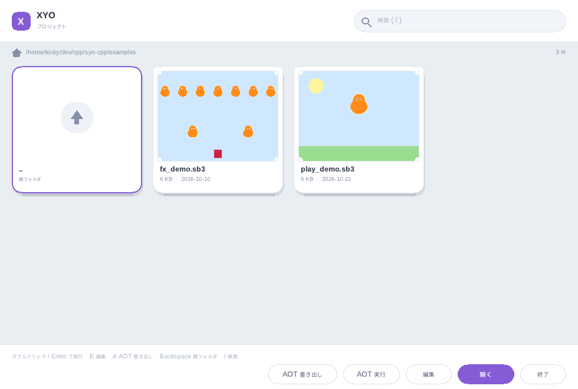

# ランチャー GUI

`xyo`（引数なし）または `xyo gui [dir]` で開くプロジェクト選択画面です。



## 構成

- **ヘッダー**: ロゴ、タイトル、検索欄。検索欄クリック・`/`・`Ctrl+F` で入力開始、`Esc` で解除。
- **パス行**: 現在のフォルダと件数。
- **カードグリッド**: `.sb3` / `.sb2` とフォルダをカードで表示。
  - プロジェクトは背景コスチュームと表示中スプライトを sb3 からデコードした**実サムネイル**付き。
  - 生成は**ワーカースレッド**で行い、UI スレッドはブロックしません（生成中はプレースホルダー表示）。
  - 完成した画像はパス・更新時刻・サイズをキーに `$XDG_CACHE_HOME/xyo/thumbs`（既定 `~/.cache/xyo/thumbs`）へ保存し、
    2 回目以降は数十マイクロ秒で読み込みます。削除しても安全です。
  - フォルダはフォルダカード、親フォルダは `..` カード。
- **フッター**: キーボードヒント、状態メッセージ、`開く / 編集 / AOT 実行 / AOT 書き出し / 終了`。

## 操作

| 操作 | 動作 |
| --- | --- |
| クリック | 選択 |
| ダブルクリック / `Enter` | 実行 |
| `↑` `↓` `←` `→` | 選択移動（見えない位置なら追従） |
| `PageUp` / `PageDown` | 1 画面スクロール |
| `E` | 内蔵エディタで開く |
| `A` | AOT 単体実行ファイルを書き出す（JIT 有効ビルド） |
| `Backspace` | 親フォルダ |
| ホイール | グリッド上で 1 行スクロール |
| `Esc` | 検索解除 / 終了 |

自動検証:

```sh
SDL_VIDEODRIVER=dummy SDL_AUDIODRIVER=dummy \
  XYO_GUI_ACTIONS="end,enter" ./build/xyo gui examples
```

`XYO_GUI_ACTIONS`（1 フレーム 1 アクション: `down/up/home/end/enter/run/aotrun/export/edit/back/wheeldown/wheelup/quit`）、
`XYO_GUI_EXIT_FRAMES=N`、`XYO_GUI_SHOT=path.ppm`（終了直前のフレームを保存）、`XYO_GUI_DEBUG=1` が使えます。

## 実装メモ

- 描画は SDL2 の矩形・円・三角形のみ。角丸はスキャンラインで塗り、影は半透明の角丸矩形。
- サムネイルは PNG を stb_image、SVG を nanosvg でラスタ化し、ステージ座標（480×360、y 上向き）へ
  背景とスプライトを配置して CPU で合成します（サムネイル寸法の 2 倍でラスタ化し、バイリニアで縮小）。
  デコードできないプロジェクトはプレースホルダー表示になります。
- 生成はワーカースレッド（Runtime 構築 + デコードで 1 枚 2〜3ms）。UI スレッドは完成分を
  1 フレーム最大 8 枚テクスチャ化するだけで、スクロール中もフレーム時間は変わりません。
- スクロールは**行単位**（カードがヘッダー／フッターにまたがらない）。SDL2-compat の OpenGL バックエンドは
  `SDL_RenderSetClipRect` を確実には適用しないため、描画クリップに頼らず常に 1 行まるごと表示します。
- 選択の自動追従は選択が変わったときだけ行います（ホイールでスクロールした位置が毎フレーム引き戻されないように）。
- サムネイルの合成は SDL に依存しません（ワーカースレッドで完結）。
