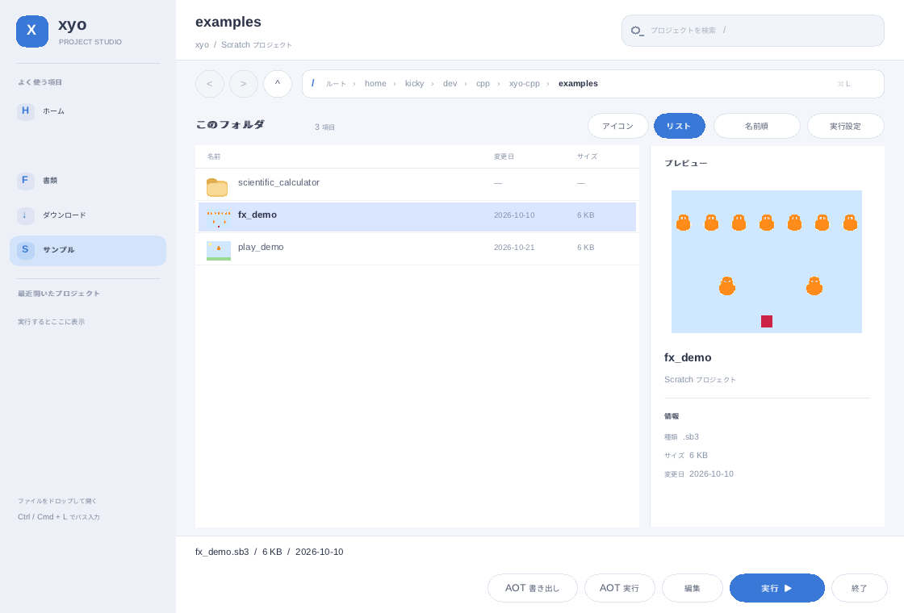
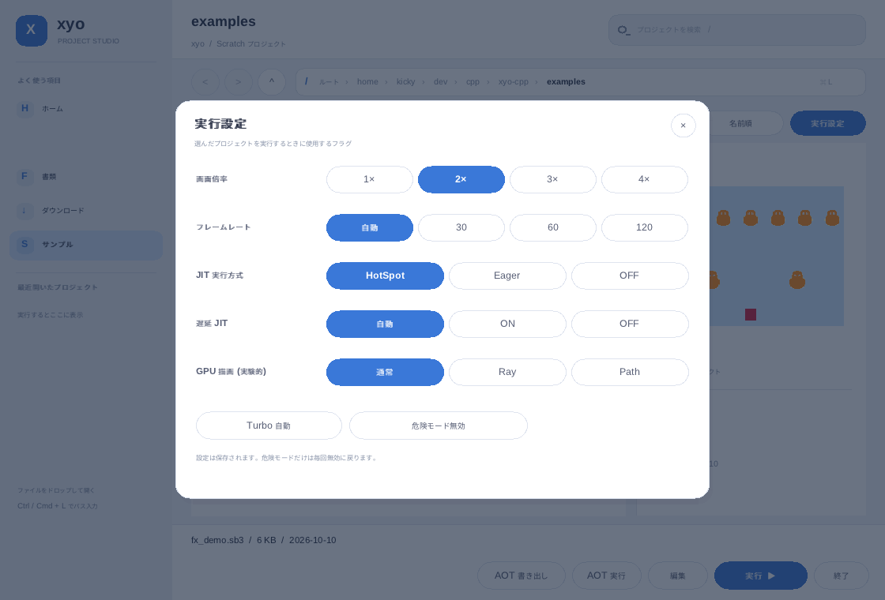

# プロジェクトランチャー（Finder 風の画面）

`xyo`（引数なし）または `xyo gui [dir]` で起動します。macOS Finder の操作感を参考に、Scratch プロジェクトのファイル管理と実行を統合しています。



## 実行フラグ（GUIから設定）

右上の **「実行設定」**（macOS は `⌘,`、Windows/Linux は `Ctrl+,`、共通で `F4`）を開くと、再生時のフラグをマウスで設定できます。



| 設定 | 選択肢 | 再生時の挙動 |
| --- | --- | --- |
| 画面倍率 | 1× / 2× / 3× / 4× | `--scale N` |
| FPS | 自動 / 30 / 60 / 120 | `--fps N`、自動はプロジェクトの設定を優先 |
| JIT | HotSpot / Eager / OFF | `--jit=hotspot\|eager\|off` |
| 遅延JIT | 自動 / ON / OFF | `--jit-lazy=auto\|on\|off`（JIT OFF時は無効） |
| GPU描画 | 通常 / Ray / Path | `--gpu-realtime ray\|path`（実験的。非対応環境では通常再生へ戻る） |
| Turbo | 自動 / 強制ON | `--turbo`。自動ではプロジェクト内のTurbo設定を維持 |
| 危険モード | OFF / ON | `--danger`。1スレッドの実行時間制限が解除されるため注意 |

倍率・FPS・JIT・遅延JIT・GPU・Turboは次回起動時も保持します。危険モードは意図しない再有効化を防ぐため保存せず、毎回OFFで開始します。設定は現在選択したプロジェクトの**再生時**に適用され、再生終了後は一時的な環境設定を復元します。AOT実行にも表示・GPU・Turbo設定を渡します。**AOT実行を明示的に選んだ場合は、JITがOFFでもコンパイル済みAOTコードを優先**します。

設定ファイルは `gui-settings.txt` で、最近開いた項目の履歴ファイルと同じディレクトリに保存します。設定パネルは`Esc`で閉じられます。

## 画面構成

- **左サイドバー**: ホーム、デスクトップ、書類、ダウンロード、サンプルを開く。下に最近実行・編集した5件を表示（画面の高さに合わせて省略）。
- **上部ツールバー**: 戻る／進む／親フォルダ、クリック可能なパンくずパス、パスの直接入力、プロジェクト名による絞り込み。
- **表示切り替え**: リスト／アイコン。リストは名前・変更日・サイズを表示し、ウィンドウが広ければ右側にステージのプレビューとプロジェクト情報を表示する。アイコン表示ではステージのサムネイル付きカードを並べる。
- **並び替え**: 名前順／更新日順。フォルダが先頭に並ぶ。
- **操作バー**: 選択された .sb3/.sb2 を実行・編集する。LLVM JIT 付きビルドでは AOT 実行と書き出しにも対応し、フォルダ選択中の操作は無効化する。
- **ドラッグ＆ドロップ**: .sb3/.sb2 またはフォルダをウィンドウにドロップすると、その場所を表示・選択する。
- **最近開いた項目**: macOS では `~/Library/Application Support/xyo/recent-projects.txt`、Linux では `$XDG_STATE_HOME/xyo/recent-projects.txt`（既定 `~/.local/state/xyo/`）に保存する。Windows は `%APPDATA%/xyo/` に保存する。

## 操作

| キー・操作 | 内容 |
|---|---|
| クリック | ファイル選択 |
| ダブルクリック／Enter | フォルダを開く・プロジェクトを実行 |
| `E` | 選択したプロジェクトを編集 |
| `A` | AOT 実行ファイルを書き出す（LLVM JIT付きビルド） |
| `⌘1`/`Ctrl+1` | アイコン表示 |
| `⌘2`/`Ctrl+2` | リスト表示 |
| `⌘L`/`Ctrl+L` | 現在のフォルダパスを編集・直接入力（テキストを選択した状態） |
| `⌘F`/`Ctrl+F`、`/` | 検索欄にフォーカス |
| `Esc` | 検索・パス入力を解除。通常時は終了 |
| `↑`/`↓` | リストやカードの選択移動 |
| リスト表示の `←`／`→` | 上のフォルダへ／選択したフォルダを開く |
| `⌘↑`/`Ctrl+↑`、`Backspace` | 親フォルダへ |
| `⌘↓`/`Ctrl+↓` | 選択した項目を開く |
| `Alt+←`／`Alt+→` | 戻る／進む（選択とスクロール位置も復元） |
| `PageUp`／`PageDown` | ページ移動 |
| `F5` | フォルダを再読み込み |

入力欄ではクリップボードの貼り付けとUTF-8の削除に対応しています。パスをクリックした場合は直接入力になり、パンくずの各階層をクリックすればそのフォルダへ移動できます。

## サムネイルと負荷

サムネイル生成は専用ワーカースレッドで行い、PNG/SVGをステージ上に合成します。描画スレッドは完了した画像だけをSDLテクスチャへ変換し、画面に表示されている項目を中心に生成します。キャッシュは `$XDG_CACHE_HOME/xyo/thumbs`（既定 `~/.cache/xyo/thumbs`）を使います。

SDL2のソフトウェア描画も利用でき、Retina/高DPIディスプレイではウィンドウ座標でレイアウトして描画を拡大します。

## 自動検証

```sh
SDL_VIDEODRIVER=dummy SDL_AUDIODRIVER=dummy \
  XYO_GUI_ACTIONS="view-list,view-icons,view-list,sort,quit" \
  ./build/xyo gui examples
```

`XYO_GUI_ACTIONS` は1フレームに1アクションを実行します。従来の `down/up/home/end/enter/run/aotrun/export/edit/back/wheeldown/wheelup/quit` のほか、`view-list`、`view-icons`、`backnav`、`forward`、`browse-home`、`examples`、`sort`、`path:<dir>`、`search:<word>`、`recent0`、`resize:760x560` を使えます。`XYO_GUI_EXIT_FRAMES=N` と `XYO_GUI_SHOT=path.ppm` で指定フレーム後の画像を保存できます。`XYO_GUI_DEBUG=1` は標準エラーへデバッグ情報を出力します。
