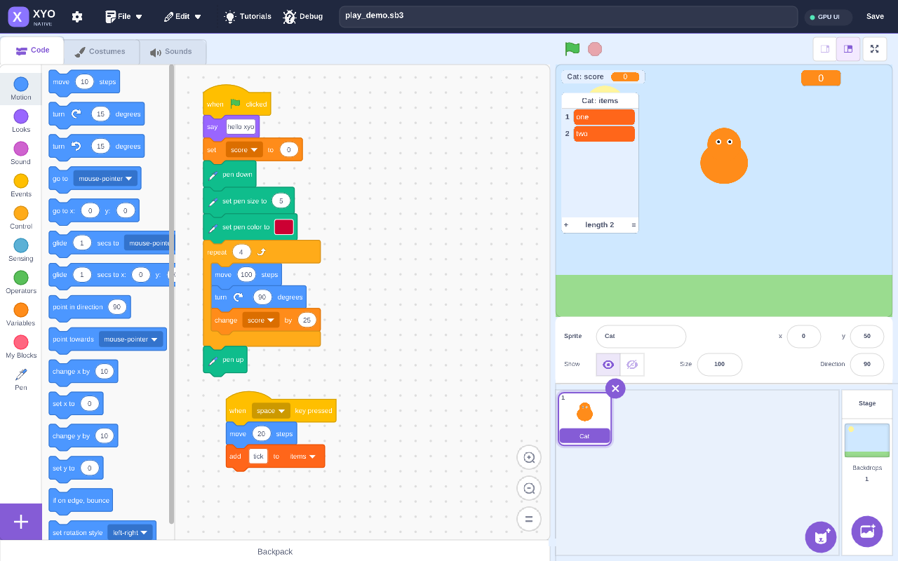

# Native エディタ

`xyo edit project.sb3` は既存のブロック編集 UI を専用のバッチ描画基盤で描きます。Dear ImGui はビルド・実行ともに不要です。ウィンドウと GPU バックエンドには既存の SDL2（2.0.18 以降）、フォントには既存の vendored stb_truetype を使用します。



## 起動と最小構成

```sh
cmake -S . -B build-native -G Ninja -DCMAKE_BUILD_TYPE=Release \
  -DXYO_JIT=OFF -DXYO_RSVG=OFF -DXYO_REQUIRE_SDL2=ON \
  -DXYO_BUILD_TESTS=OFF
cmake --build build-native
./build-native/xyo edit examples/play_demo.sb3
```

この構成は外部 UI ライブラリを使用せず、既存の SDL2 と zlib（プロジェクト ZIP の読み込み）を利用します。標準 C/C++ ランタイム、OS・OpenGL 等のグラフィックスドライバ、および SDL2 自体の推移的な依存は別途必要です。「依存ゼロ」のネイティブウィンドウ実装ではありません。LLVM JIT を使う場合は `XYO_JIT=ON`、SVG 内の text/tspan の描画が必要な場合は `XYO_RSVG=ON` にしてください。RSVG 無効時は既存の nanosvg フォールバックを使います。

## 描画方式

- 頂点・インデックスを再利用可能な配列に記録し、隣接する同一テクスチャ・クリップの命令をまとめて SDL_RenderGeometry に送ります。各バッチには、そのバッチで使う頂点範囲と相対インデックスだけを渡します。フレーム全体の頂点を各バッチへ重複送信しません。描画順は維持します。
- 画面外のブロックはパス生成・文字描画の前に除外します。ドラッグ中のスクリプトはジェスチャー開始時に一度だけ相対レイアウトを計算し、各フレームはマウス位置に合わせて平行移動します。
- SDL2 の accelerated renderer を優先し、利用できない場合は software renderer にフォールバックします。ヘッダーの GPU UI / CPU UI バッジと起動ログは選択された SDL renderer の属性を示します。GPU UI は物理 GPU の実行を保証する表示ではなく、Mesa ソフトウェアドライバ等も accelerated API として報告されることがあります。
- フォントの計測値は起動時から利用できます。グリフは必要になったときにラスタライズし、ページ単位のアトラスに保持します。文字列ごとの SDL_Texture 作成はしません。
- UI は 60 Hz を目標に描画し、Scratch の実行は従来通り 30 Hz で更新します。フレーム数指定の自動検証時は従来の 1 フレーム = 1 実行ステップを維持します。
- ワークスペースのカメラ移動: 空白部分の左ドラッグ、中ボタンドラッグ、`Space` + 左ドラッグ、ホイール（`Shift` + ホイールで横方向）に対応します。ドラッグ中は移動カーソルになります。
- ブロックのモデル、レイアウト、ドラッグ接続、undo/redo、保存、ステージの実行は既存実装を共有します。ステージも既存の SDL レンダラをそのまま使用します。
- グラファイト色のヘッダー、紫のアクセント、描画バックエンド表示を加え、ブロックのカテゴリ色と編集配置は従来通りにしています。

## 検証用フック

```sh
# ディスプレイ無しで操作・描画の検証
SDL_VIDEODRIVER=dummy SDL_AUDIODRIVER=dummy \
  XYO_EDIT_TEST=1 ./build-native/xyo edit examples/play_demo.sb3

SDL_VIDEODRIVER=dummy SDL_AUDIODRIVER=dummy \
  XYO_EXIT_FRAMES=3 XYO_EDIT_STATS=1 XYO_EDIT_SHOT=/tmp/editor.ppm \
  ./build-native/xyo edit examples/play_demo.sb3
```

`XYO_EDIT_STATS=1` は初回フレームの頂点数・インデックス数・バッチ数を stderr へ表示します。`XYO_INJECT`、`XYO_EDIT_SAVE`、`XYO_EDIT_TARGET` など既存の検証フックも引き続き使えます。

GPU の検証は GPU が利用できる環境で行ってください。`SDL_VIDEODRIVER=dummy` での成功はソフトウェア描画の検証であり、GPU 動作の証明にはなりません。速度向上率はワークロードやドライバで変わり、本実装では倍率を保証しません。

この開発環境では `SDL_VIDEODRIVER=offscreen`、`SDL_RENDER_DRIVER=opengl`、NVIDIA EGL vendor 指定で RTX 3070 の描画を確認しました。起動ログの GL device も NVIDIA GeForce RTX 3070 と表示されました。デモの初回フレームは 49,205 頂点、154,863 インデックス、236 バッチです。

`XYO_BUILD_TESTS=ON` のビルドには、専用描画・フォントアトラス・編集操作の回帰テストも登録されます。

```sh
ctest --test-dir build --output-on-failure
```

## 描画負荷とハット追従の修正

SDL2-compat は SDL_RenderGeometryRaw の `num_vertices` 個すべての色を呼び出しごとに変換します。以前は各バッチへフレーム全体を渡していたため、デモでは 49,205 頂点 × 236 バッチ = 11,612,380 頂点／フレームを処理していました。現在は全バッチの合計で 49,205 頂点です。

RTX 3070、SDL2-compat 2.32.74、offscreen OpenGL での修正前後の実測値（先頭10フレームを除いた平均）：

| 静止ワークスペース | 描画送信時間・修正前 | 修正後 | フレーム間隔・修正前→修正後 |
| --- | ---: | ---: | ---: |
| デモ（120フレーム） | 18.46 ms | 1.09 ms | 21.05→16.76 ms |
| 600ブロックの長いスクリプト（40フレーム） | 94.95 ms | 1.24 ms | 99.17→16.79 ms |

送信時間は SDL_RenderGeometryRaw 呼び出しの CPU 側所要時間で、GPU タイムスタンプではありません。フレーム間隔は60 Hzの待機時間を含みます。実プロジェクトの速度は、実行中の処理やステージ描画にも依存します。デモの静止スクリーンショットは修正前後で byte 一致を確認しています。

ハットは入力側の接続を持たないため、下へ差し込む候補から除外し、スクリプト末尾の接続点で他のトップレベルスクリプトの前へ接続します。接続後に新しい先頭座標を保持することで、古い位置へのジャンプを防ぎます。論理的な行の上にはみ出すドーム部分も実際の輪郭でヒットテストし、ドームを掴んだ場合の負の縦オフセットも維持します。パン・ズーム・ドームからのドラッグ・連続マウス移動・最後の移動イベントが省略されたリリースを回帰テストで検証しています。

カメラ操作は回帰テスト（`src/shell/editor_drag_tests.inc`）で、空白左ドラッグ・中ドラッグ・`Space` + ドラッグ・ホイール・`Shift` + ホイールの移動量を検証しています。
