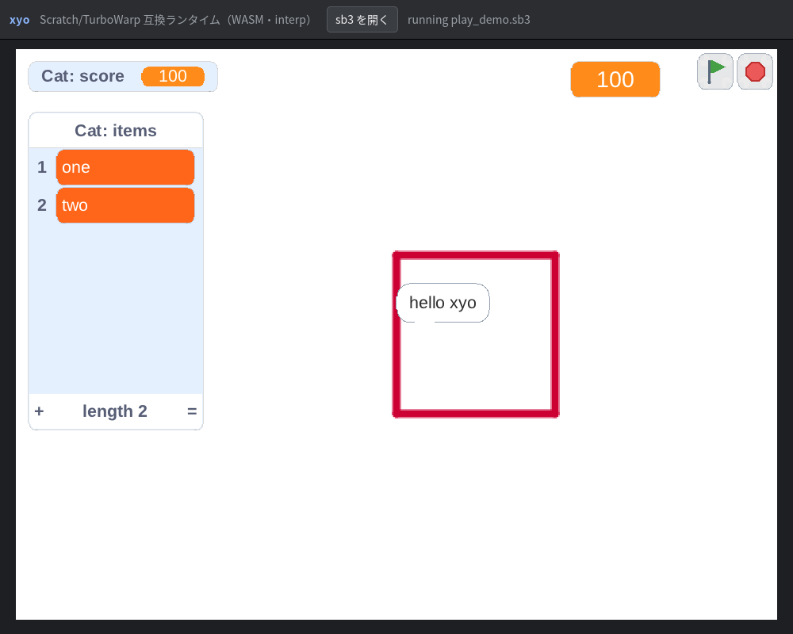

# WASM (Emscripten) ビルド — Phase A

xyo-cpp を WebAssembly へクロスコンパイルする手順と、その技術的制約・
ロードマップ。ツールチェーンは **Emscripten（emsdk）**。

> **Phase A の範囲**: インタプリタ（interp）のみ + SDL2 canvas 描画 +
> headless `run`/`dump`/`test`。**JIT は無効**。GPU（Vulkan/GL compute・
> GPU ペン層）は CPU フォールバック。WebGPU / WASM モジュール化 JIT は
> §5 のロードマップ（Phase B / C）を参照。

---

## 1. 前提: Emscripten の導入

```sh
git clone --depth 1 https://github.com/emscripten-core/emsdk.git "$HOME/.emsdk"
cd "$HOME/.emsdk"
./emsdk install latest
./emsdk activate latest
source "$HOME/.emsdk/emsdk_env.sh"        # 以降の手順の前に必ず
```

検証環境: emsdk **6.0.12**（SDL2 port 2.32.10 / zlib port 1.3.2 を ports から取得）。

## 2. headless CLI ビルド（Node で実行）

`run` / `dump` / `test` を実ファイルに対して動かす構成。SDL2 は不要。

```sh
source "$HOME/.emsdk/emsdk_env.sh"
cd <repo>
emcmake cmake -B build-wasm -G Ninja \
  -DCMAKE_TOOLCHAIN_FILE=cmake/emscripten.cmake \
  -DCMAKE_BUILD_TYPE=Release \
  -DXYO_SDL2=OFF -DXYO_BUILD_TESTS=OFF
cmake --build build-wasm                 # → build-wasm/xyo.js + xyo.wasm
```

実行（`-sNODERAWFS` により Node から実ファイルを直接読める）:

```sh
node build-wasm/xyo.js dump mysb3.sb3
node build-wasm/xyo.js run  mysb3.sb3 --frames 120
node build-wasm/xyo.js test refs/scratch-vm/test/fixtures/execute
```

## 3. ブラウザ `play` ビルド（SDL2 canvas）

SDL2 を ports から有効化し、Asyncify で `play` ループの `sleep`/`poll` を
ブラウザのイベントループへ譲る。出力は HTML シェル + `.wasm`。

```sh
source "$HOME/.emsdk/emsdk_env.sh"
emcmake cmake -B build-wasm-web -G Ninja \
  -DCMAKE_TOOLCHAIN_FILE=cmake/emscripten.cmake \
  -DCMAKE_BUILD_TYPE=Release \
  -DXYO_SDL2=ON -DXYO_WASM_ASYNCIFY=ON -DXYO_BUILD_TESTS=OFF
cmake --build build-wasm-web             # → build-wasm-web/xyo.html + xyo.wasm
```

静的サーバで配信して `xyo.html` を開く（`file://` は不可）:

```sh
python3 -m http.server -d build-wasm-web 8000
# → http://localhost:8000/xyo.html に sb3 をドロップ
```

- シェルは `web/shell.html`（`--shell-file`）。`-sINVOKE_RUN=0` なので main は
  自動実行せず、JS 側が `Module.callMain(["play", path])` で起動する。
- ドロップ/ファイル選択した sb3 は `Module.FS`（MEMFS）へ書き込まれる。
- `?sb3=<url>` を付けると起動時にその URL を読み込んで自動再生する
  （デモ・自動検証用）。例: `xyo.html?sb3=play_demo.sb3`
- 音声はブラウザの自動再生ポリシーにより、ユーザー操作まで無音のことがある
  （既存の「デバイス無しは即解決」経路で動作は継続する）。



> **検証状況（ブラウザ実機で確認済み）**: headless Chrome
> （chrome-headless-shell 131 + puppeteer-core）で `xyo.html?sb3=play_demo.sb3`
> を開き、SDL2 canvas にステージ・スプライト・発話バブル・モニタ
> （default/slider/list、scratch-gui 準拠の色）が描画されることを確認した
> （上図 `docs/wasm-browser.png`、canvas 960×720、ページエラー無し）。
> headless CLI（Node）は execute フィクスチャ **116/116**（assert 339、
> ネイティブ interp と一致）。Asyncify 有効ビルドも 116/116。

## 4. 実装メモ（Phase A で入れた差分）

| 箇所 | 内容 |
| --- | --- |
| `cmake/emscripten.cmake` | emsdk の toolchain を読み込み `XYO_JIT=OFF` を強制 |
| `CMakeLists.txt` | EMSCRIPTEN 分岐: zlib は `-sUSE_ZLIB=1`、SDL2 は `-sUSE_SDL=2`、Vulkan GPU executor を除外、CLI へ NODERAWFS / Asyncify / スタック増量 |
| `src/engine/fiber.{hpp,cpp}` | wasm 用 `FiberRegs` スタブ + malloc 領域 + `xyo_fiber_switch`/`trampoline` を abort スタブ。**interp は fiber を使わない**（fiber は JIT 専用）ため Phase A では到達しない |
| `src/core/gc.cpp` | wasm スタックの保守的スキャン（`emscripten_stack_get_base()` と現 SP）。**これが無いと GC がスタック上のルートを取りこぼし UAF になる** |
| `src/jit/rtprof.hpp` | `__rdtsc`（x86 専用）を `rtProfNow()` に抽象化。非 x86 は `steady_clock` ns |
| `src/model/blocks.{hpp,cpp}` | `Block::seq`（ロード順）を導入し、`getProcedureDefinition` / `getProcedureParamNamesIdsAndDefaults` を **seq 最小 = TW の「最初の出現」**で決定的に解決（下記 §6） |
| `src/render/sdl_renderer.cpp` | 非 GL ビルドの `penStrokeGpu` スタブの引数個数不一致を修正（潜在バグ。Linux は常に `XYO_PEN_GL` のため未踏だった） |
| `src/shell/gui.cpp` | `editor.hpp` を `#ifdef XYO_JIT` の外へ（JIT OFF でも `editorMain` を参照するため） |

## 5. ロードマップ

### Phase B — WebGPU 実行層

`src/gpu/` の**解析部（CFG 固定点解析・f32 VM バイトコード生成・64bit ペン順序
ID）はバックエンド非依存**なのでそのまま流用できる。差し替えるのは実行部のみ。

- **B1**: WebGPU compute executor（`RendererAPI::gpuExecParallel` 相当）。
  Emscripten の `webgpu/webgpu.h` + `-sUSE_WEBGPU` で、既存 Vulkan 経路
  (`gpu_vulkan.cpp`) と同じ SSBO レイアウト・workgroup 構成を WGSL へ移植。
  失敗時は従来どおり CPU へフォールバック（既存の実行時ガードを流用）。
- **B2**: GPU ペン層（GL FBO + カプセル距離シェーダ → WebGPU レンダーパス）。
  CPU ラスタと byte 一致の回帰は既存 `tests/bench` の `--compare`（SSIM）で。
- **B3**: ステージ描画そのものの WebGPU 化（現状は SDL2 = WebGL/canvas）。
  これは SDL レンダラの置換になるため独立タスク。

### Phase C — wasm モジュール化 JIT（実行時に wasm を生成して JS が実行）

**ネイティブの LLVM ORC JIT はブラウザでは原理的に動かない**（§7）。方式は
「**wasm ランタイム自身が wasm バイナリを生成し、JS が
`WebAssembly.instantiate` で読み込んで実行する**」に確定した。ランタイムは
wasm なので LLVM を積めず、**wasm エンコーダは自前で書く**。

#### 確立済みのアーキテクチャ（実機検証済み）

1. **メモリ共有**: ランタイムを `-sIMPORTED_MEMORY=1 -sMODULARIZE=1` で
   ビルドし、`WebAssembly.Memory` は JS が生成して `createXyo({wasmMemory})`
   で渡す。生成モジュールは同じ Memory を `env.memory` として **import**
   するので、`JitCtx*`・`SStr*`・`Variable*`・`SList*` はすべて同じ線形
   メモリのオフセットとして**直接読み書き**できる。
2. **ヘルパ呼び戻し**: 生成モジュールはランタイムのヘルパを `env.<name>`
   として import する（JS が `Module._xyo_rt_*` を渡す）。生成コード →
   ランタイムの呼び出しが成立する。
3. **instantiate のブリッジ**: ランタイムは生成したバイト列を線形メモリに
   置き、`EM_JS` で宣言した import（`xyo_host_instantiate(ptr,len) -> handle`）
   を呼ぶ。JS が同期で `WebAssembly.instantiate` してハンドルを返し、実行は
   `xyo_host_invoke(handle, ctxPtr)` で `exports.f(ctxPtr)` を呼ぶ。
4. **yield 制約**: wasm モジュール関数は native fiber のように途中中断
   できないため、**`CompiledScript::mayYield == false` のスクリプトだけ**を
   wasm 化する（warp 演算ループ等が該当）。yield し得るものは従来どおり
   インタプリタへフォールバックする。既存の `mayYield` をそのまま使い、
   意味論は変えない。

#### 実装済み（土台）

- `src/wasm/wasm_emit.hpp`: wasm バイナリエンコーダ（type / import /
  function / export / code セクション、LEB128、i32/i64/f32/f64 命令、
  制御構文、メモリアクセス、ローカル）。依存は STL のみで wasm32 でも動く。
- `src/wasm/host_bridge.{hpp,cpp}`: **JS ブリッジ**。`xyo_host_instantiate
  (bytes,len)` が JS 側で同期 `WebAssembly.instantiate` してハンドルを返し、
  `xyo_host_invoke(handle,ctx)` が生成モジュールの `f(ctx)` を呼ぶ。import は
  `env.memory`（ランタイムの共有 Memory）と `env.h`（ヘルパディスパッチャ =
  ランタイムが export する `_xyo_wasm_h`）。
- `src/wasm/jit_selftest.cpp` + `wasm-selftest` コマンド: 実ランタイム内で
  「エンコーダ → instantiate → invoke → 生成コードがランタイムのメモリへ
  書き・ヘルパを呼び戻す」を 1 コマンドで検証する。
- `web/xyo-node.mjs`: MODULARIZE ビルド用の Node ローダ。JS が
  `WebAssembly.Memory` を作り `createXyo({wasmMemory, arguments})` で起動する。
- `tests/unit/test_wasm_emit.cpp`（構造検証 11 チェック、`XYO_WASM_EMIT_OUT`
  でダンプ）/ `tests/wasm/instantiate_check.mjs`（Node で instantiate）。
- `src/wasm/wasm_compile.{hpp,cpp}`: **スクリプト → wasm コンパイラのコア**。
  ABI は `f(i32 slots) -> i32`（`slots` は `i64[n]` の Value ビット列、返り値
  0=完走 / 1=bail）。対応: 数値リテラル・変数読み書き・`change by`・
  四則/`mod`/`round`/`neg`・`repeat`。変数は **`Value` ビットを直接 load/store**
  し（数値タグはインライン、非数値タグは bail）、算術入力の NaN は 0、
  代入時の NaN は `kNan` へ正規化する。`repeat` 回数は `floor(x+0.5)`。
  非対応 opcode は `Program` 構築段階で除外し interp へフォールバックする。
- `lowerScript(Blocks&, const Block* top, Program&)`: **実ブロック木 → `Program`**。
  `data_setvariableto`/`data_changevariableby`/`data_variable`/`operator_add|
  subtract|multiply|divide|mod|round`/`control_repeat`/数値 shadow を lowering し、
  非対応 opcode を含むスクリプトは `false`（= interp へフォールバック）。
  変数は `VARIABLE` フィールドの id で slot に割り当てる。
- `tests/unit/test_wasm_compile.cpp` + `tests/wasm/compile_check.mjs`:
  `v0=0; repeat 1000 { v0=v0+1 }; v1=v0*2; v2=7-2; v3=10/4` を生成・実行し
  `1000 / 2000 / 5 / 2.5` を検証。さらに実 `Blocks`（ハット→set→repeat→
  set→add→variable）を `lowerScript` で落として **357 バイト**のモジュールを生成し、
  Node で実行して `x=1000` を確認（非対応 opcode が `false` になることも検証）。

ビルド（Node、JIT ブリッジ有効）:

```sh
source "$HOME/.emsdk/emsdk_env.sh"
emcmake cmake -B build-wasm-jit -G Ninja \
  -DCMAKE_TOOLCHAIN_FILE=cmake/emscripten.cmake \
  -DCMAKE_BUILD_TYPE=Release -DXYO_SDL2=OFF -DXYO_WASM_JIT=ON -DXYO_BUILD_TESTS=OFF
cmake --build build-wasm-jit
node web/xyo-node.mjs build-wasm-jit/xyo.js wasm-selftest
```

検証結果（実測）:

1. エンコーダが生成した **82 バイト**のモジュールを `WebAssembly.instantiate`
   し、`env.memory` / `env.helper_add` を import して `f(4)=104 / mem[4]=104`。
2. **実ランタイム内での全経路**（`-sIMPORTED_MEMORY=1 -sMODULARIZE=1`）:
   `node web/xyo-node.mjs build-wasm-jit/xyo.js wasm-selftest` →
   `bytes=78 handle=0 cell=12` / **PASS**。生成コードが `_xyo_wasm_h(1,7,5)`
   を呼び戻し、その結果 12 をランタイムの実メモリへ書き、C++ 側が読めた
   （メモリ共有・呼び戻し・書き戻しの全経路）。
3. **スクリプト→wasm コンパイラ（実ランタイム内）**:
   `node web/xyo-node.mjs build-wasm-jit/xyo.js wasm-selftest` →
   `selftest2: code=490 handle=1 v0=1000.0 v1=2000.0` / **PASS**。
   wasm ランタイムの中で wasm を生成し、JS が instantiate して 1000 回の
   ループを実行、変数が期待値になることを確認。
4. **JIT モードのランタイムは意味論不変**: `xyo-node.mjs ... test
   refs/scratch-vm/test/fixtures/execute` が **116/116（assert 339）**、
   ネイティブ interp と一致。

#### 残作業

1. **`lowerBlocks`（ブロック木 → `Program`）**: `Blocks` を走査して
   対応 opcode（`data_variable`/`data_setvariableto`/`data_changevariableby`/
   `operator_add|subtract|multiply|divide|mod|round|mathop`/`control_repeat`/
   `control_if`）を `Program` へ落とし、それ以外を含むスクリプトは除外する。
   変数は `Variable**`（`JitCtx::varSlotData`）経由で `Variable::value` の
   オフセットを実行時に埋め込む。
2. **JitEngine への組み込み**: wasm ターゲット用の `CompiledScript` を作り、
   `jitStepThread` から `xyo_host_invoke` で呼ぶ（`mayYield` でゲート）。
   インタプリタ / ネイティブ JIT とのフォールバック関係を整理する。
3. **検証**: 非 yield スクリプト（warp ループ）の wasm 実行結果が
   インタプリタと一致すること（`XYO_DUMPVARS` で全変数を比較）。
4. **ブラウザでの通し確認**: `XYO_WASM_BROWSER` + `XYO_WASM_JIT` の組み合わせ
   （MODULARIZE 形のシェル対応）と、ブラウザでの instantiate 検証。

## 6. 決定的な手続き解決（Phase A で修正した実バグ）

TurboWarp は `blocks` を JS オブジェクトとして**挿入順**にイテレートするため、
同一 `proccode` の定義が複数あるときは「最初の出現」を選ぶ。移植当初は
`std::unordered_map` のイテレーション順に依存していたため、順序が
**実装依存**（libstdc++ と libc++ で異なる）になっていた。

- 顕在化条件: sb3 ローダが ID 無し shadow ブロックへ `xyo_%08x` を振る
  **プロセス全体の連番**（`g_uidCounter`）ため、同一プロセスで複数プロジェクトを
  ロードすると ID が変わり、`unordered_map` のバケット配置が変わる →
  「最初の出現」が入れ替わる。`xyo test <dir>` は 116 件を 1 プロセスで回すため、
  ネイティブでは偶然通っていたものが WASM（libc++）で 1 件落ちた。
- 修正: `Block::seq`（`createBlock` 順の単調増加）を導入し、`seq` 最小の定義を
  選ぶ。ローダの元データは `std::map`（ID 昇順）なので、これは移植コードに
  おける「最初の挿入」と一致し、TW の期待結果と一致する。
- 検証: `refs/scratch-vm/test/fixtures/execute` の
  `tw-prefers-first-occurence-of-procedure-*.sb3` が、**単体・ディレクトリ一括の
  どちらでも**通る（ネイティブ/WASM 双方）。

## 7. なぜ「ネイティブ JIT」はブラウザで不可能か

- WebAssembly の線形メモリは**実行不可**。`mmap(PROT_EXEC)` 相当が無く、
  サンドボックス外のネイティブコードを生成・実行できない。
- 現行 `src/jit/` は LLVM **ORC JIT**（ネイティブコード生成・実行）と
  `fiber_x86_64_*.S`（x86 asm のコンテキストスイッチ）に依存しており、
  どちらもブラウザ WASM では成立しない。
- したがって「WASM でコンパイル速度」は §5 Phase C の WASM モジュール化
  （実質 AOT 寄り）だけが現実的な道。ネイティブ x86 の JIT をそのまま
  持ち込むことはできない。

## 8. 既知の制約（Phase A）

- JIT 無効（interp のみ）。`XYO_JIT=OFF` 相当。
- Vulkan/GL compute と GPU ペン層は無効 → CPU フォールバック。
- librsvg / Cairo / Pango は Emscripten に無いため SVG コスチュームは vendored の
  **nanosvg** でラスタ化する（図形のみ。`<text>`/`<tspan>` の文字は描かれない）。
- 並列スケジューラは無効（Emscripten 単一スレッド構成。
  `parallelEnabled()` は JIT 前提で false になる）。
- `xyo gui` / `xyo edit` はブラウザシェル未対応（`play` のみ）。
- WASM のスタックは既定 64KiB → 本ビルドは `-sSTACK_SIZE=5242880`（5MiB）。
