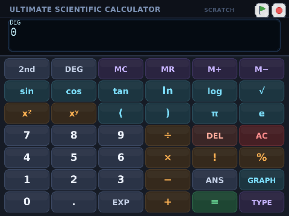
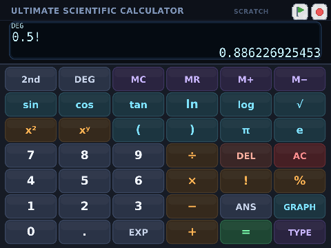
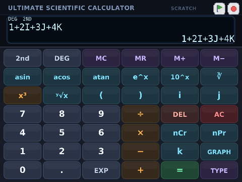
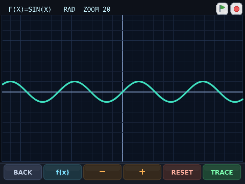
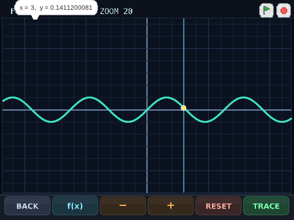

# ULTIMATE SCIENTIFIC CALCULATOR

Scratch 3 / TurboWarp で動く、式入力タイプの関数電卓です。
[`scientific_calculator.sb3`](../../scientific_calculator.sb3) を Scratch 3 または TurboWarp で開き、緑の旗を押してください。



## できること

- 式をそのまま入力して評価（括弧、演算子の優先順位、暗黙の積、閉じ括弧の自動補完）
- 三角関数・逆三角関数・双曲線関数・対数・指数・累乗根・nCr/nPr・GCD/LCM・sum/avg など
- 実数の階乗とガンマ関数（非整数・負の非整数も）
- 複素数（`i`）と四元数（`i`, `j`, `k`）の四則演算・関数
- Ans、メモリ（M+/M-/MR/MC）、DEG/RAD、2nd シフト
- グラフ（RAD 固定、ズーム、リセット、トレース）
- `TYPE` キーでキーボードから式を直接入力

## 操作

### 基本

- 数字・演算子・関数キーで式を作り、`=` で評価します。評価前にもプレビュー結果が右下に出ます。
- `DEL` は1文字削除、`AC` は全消去。
- `2nd` で第2面に切り替わります。`2nd` はもう一度押すまで維持されます。
- `DEG` で角度モードを切り替えます（計算画面のみ。グラフ画面は常に RAD）。
- `ANS` は直前の結果、`M+`/`M-` はメモリへの加減算、`MR` は呼び出し、`MC` はクリア。
- `TYPE` で式を直接入力できます（例: `1+2i+3j+4k`）。入力バーで Enter または右下のチェック。
- `GRAPH` でグラフ画面へ。`f(x)` で式を入力、`−`/`+` でズーム、`RESET` でリセット、`TRACE` でトレース。

### 複素数・四元数のキー

第2面の次のキーが虚数単位です。

- `i` … 第2面の `π` の位置
- `j` … 第2面の `e` の位置
- `k` … 第2面の `ANS` の位置

通常面の `π` / `e` / `ANS` はそのまま使えます。

## 文法

### 演算子

`+` `-` `*` `/` `^`、後置の `!`（階乗）と `%`（100で割る）、単項マイナス。

暗黙の積を許します: `2pi`、`3i`、`2(3+4)`、`2sin(30)`。
閉じ括弧は自動で補完されます。

### 定数

`pi`、`e`、`tau`、`phi`、`ans`、`mem`、`i`、`j`、`k`。

### 関数

- 三角: `sin` `cos` `tan` `asin` `acos` `atan`
- 双曲線: `sinh` `cosh` `tanh` `asinh` `acosh` `atanh`
- 対数・指数: `ln` `log` `log2` `exp`
- 累乗根: `sqrt` `cbrt` `root(x, n)`
- 複素数・四元数: `abs` `norm` `arg` `conj` `re` `im` `jpart` `kpart` `inv`
- 整数・実数: `floor` `ceil` `round` `sign` `mod`
- 可変長: `min` `max` `sum` `avg` `gcd` `lcm` `hypot`
- その他: `atan2(y, x)` `deg` `rad` `ncr` `npr` `pow(a, b)` `gamma`

`log(x)` は常用対数（底10）、`ln(x)` は自然対数、`log(b, x)` は底 `b` の対数です。

### 実数の階乗・ガンマ関数

- `5!` = 120、`0!` = 1。非負整数は 170! まで厳密に計算します。
- 非整数はガンマ関数で計算します: `0.5!` = Γ(1.5) = 0.886226925453、`1.5!` = 1.32934038818。
- 負の非整数も反射公式で計算します: `(-0.5)!` = Γ(0.5) = 1.77245385091。
- 負の整数は極なのでエラーになります。`gamma(x)` も同じ規則です。
- `!` / `gamma` は実数専用です（複素数・四元数には未対応）。



### 複素数

`i` は虚数単位です。

```text
i^2            = -1
(1+i)*(1-i)    = 2
1/i            = -i
sqrt(-1)       = i
ln(-1)         = 3.14159265359i
exp(i*pi)      = -1
abs(3+4i)      = 5
conj(3+4i)     = 3-4i
arg(1+i)       = 0.785398163397   （ラジアン）
```

- 負の実数の非整数べきは主値の複素数になります: `(-8)^(1/3)` = `1+1.7320508076i`。
- 実数の三乗根 `cbrt(-27)` は実数の `-3` を返します。
- `asin(2)`、`acos(2)`、`acosh(0.5)`、`atanh(2)` などは複素数を返します。
- 複素数の三角関数・対数はラジアン基準です（DEG/RAD の表示には影響されません）。


### 四元数

`i`, `j`, `k` は四元数の虚数単位です。積は Hamilton 積で、非可換です。

```text
i*j            = k
j*i            = -k
j*k            = i
k^2            = -1
(1+i)*(1+j)    = 1+i+j+k
conj(1+2i+3j+4k) = 1-2i-3j-4k
abs(1+2i+3j+4k)  = 5.47722557505
exp(j*pi/2)    = j
```

- `+` `-` `*` `/` `^`、`abs` `norm` `conj` `inv` `re` `im` `jpart` `kpart` `arg`
- `exp` `ln` `log` `sqrt` `cbrt`、`sin` `cos` `tan`、`sinh` `cosh` `tanh`
- `sum` / `avg` は成分ごとに計算します。
- 逆三角関数 `asin` `acos` `atan` と逆双曲線 `asinh` `acosh` `atanh` は複素数専用です（`j`/`k` 成分があるとエラー）。
- `arg(q)` は四元数では `acos(w/|q|)` のスカラー角（ラジアン）です。



### 表示と精度

- 表示は大文字になります（Scratch のコストゥーム検索が大小文字を区別しないため）。`i` は `I` と表示されます。
- 通常は12桁程度、Scratch の `sin`/`cos`/`tan` は10桁丸めのため、複素三角関数の成分も10桁程度になることがあります。
- 長い結果は LCD 内でフォントサイズが自動的に小さくなります。
- グラフは実数値の点だけを描画します。虚部がある点は描画しません。

## グラフ

- `GRAPH` でグラフ画面、`BACK` で計算画面。
- `f(x)` で式を入力します。例: `sin(x)`、`x^2/10`、`exp(-x^2)`。
- グラフ画面では角度モードを RAD に固定し、計算画面へ戻ると元の DEG/RAD に戻します。
- `−`/`+` でズーム、`RESET` で初期ズーム、`TRACE` でマウス位置の `x, y` を表示。





## ビルドとテスト

```sh
python3 examples/scientific_calculator/build_calculator.py scientific_calculator.sb3
python3 examples/scientific_calculator/build_tests.py tests/fixtures/calculator_tests.sb3

./build/xyo test tests/fixtures/calculator_tests.sb3
./build/xyo test tests/fixtures/calculator_tests.sb3 --jit off
```

評価器のテストは 138 ケースで、JIT とインタプリタの両方で全ケースが通ります。
