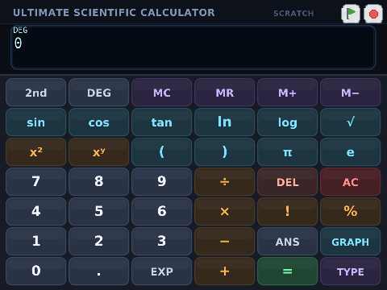
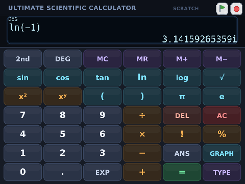
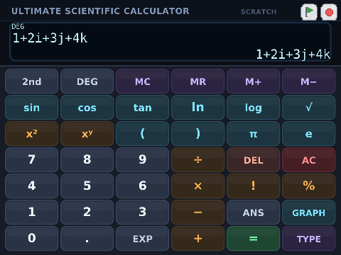

# ULTIMATE SCIENTIFIC CALCULATOR

Scratch 3 / TurboWarp で動く、式入力タイプの関数電卓です。
[`scientific_calculator.sb3`](../../scientific_calculator.sb3) を Scratch 3 または TurboWarp で開き、緑の旗を押してください。



## できること

- 式をそのまま入力して評価（括弧、演算子の優先順位、暗黙の積、閉じ括弧の自動補完）
- 三角関数・逆三角関数・双曲線関数・対数・指数・累乗根・nCr/nPr・GCD/LCM・sum/avg など
- 実数の階乗とガンマ関数（非整数・負の非整数も）
- 複素数（`i`）と四元数（`i`, `j`, `k`）の四則演算・関数
- Ans、メモリ（M+/M-/MR/MC）、DEG/RAD、2nd シフト
- 明示関数・陰関数のグラフ（適応分割、座標目盛り、パン、ズーム、曲線スナップ式トレース）
- `TYPE` キーでキーボードから式を直接入力

## 操作

### 基本

- 数字・演算子・関数キーで式を作り、`=` で評価します。評価前にもプレビュー結果が右下に出ます。
- `DEL` は1文字削除、`AC` は全消去。
- `2nd` で第2面に切り替わります。`2nd` はもう一度押すまで維持されます。
- `DEG` で角度モードを切り替えます（計算画面のみ。グラフ画面は常に RAD）。
- `ANS` は直前の結果、`M+`/`M-` はメモリへの加減算、`MR` は呼び出し、`MC` はクリア。
- `TYPE` で式を直接入力できます（例: `1+2i+3j+4k`）。入力バーで Enter または右下のチェック。
- `GRAPH` でグラフ画面へ。`EQN` で式を入力、`−`/`+` でズーム、`RESET` でリセット、`TRACE` でトレース。

### 複素数・四元数のキー

第2面の次のキーが虚数単位です。

- `i` … 第2面の `π` の位置
- `j` … 第2面の `e` の位置
- `k` … 第2面の `ANS` の位置

通常面の `π` / `e` / `ANS` はそのまま使えます。

## 文法

### 演算子

`+` `-` `*` `/` `^`、後置の `!`（階乗）と `%`（100で割る）、単項マイナス。

暗黙の積を許します: `2pi`、`3i`、`2(3+4)`、`2sin(30)`。
閉じ括弧は自動で補完されます。

### 定数

`pi`、`e`、`tau`、`phi`、`ans`、`mem`、`i`、`j`、`k`。

### 関数

- 三角: `sin` `cos` `tan` `asin` `acos` `atan`
- 双曲線: `sinh` `cosh` `tanh` `asinh` `acosh` `atanh`
- 対数・指数: `ln` `log` `log2` `exp`
- 累乗根: `sqrt` `cbrt` `root(x, n)`
- 複素数・四元数: `abs` `norm` `arg` `conj` `re` `im` `jpart` `kpart` `inv`
- 整数・実数: `floor` `ceil` `round` `sign` `mod`
- 可変長: `min` `max` `sum` `avg` `gcd` `lcm` `hypot`
- その他: `atan2(y, x)` `deg` `rad` `ncr` `npr` `pow(a, b)` `gamma`

`log(x)` は常用対数（底10）、`ln(x)` は自然対数、`log(b, x)` は底 `b` の対数です。

### 実数の階乗・ガンマ関数

- `5!` = 120、`0!` = 1。非負整数は 170! まで積で計算します。任意精度整数ではなく、倍精度浮動小数点の範囲・精度に従います。
- 非整数はガンマ関数で計算します: `0.5!` = Γ(1.5) = 0.886226925453、`1.5!` = 1.32934038818。
- 負の非整数も反射公式で計算します: `(-0.5)!` = Γ(0.5) = 1.77245385091。
- 負の整数は極なのでエラーになります。`gamma(x)` も同じ規則です。
- `!` / `gamma` は実数専用です（複素数・四元数には未対応）。


### 複素数

`i` は虚数単位です。

```text
i^2            = -1
(1+i)*(1-i)    = 2
1/i            = -i
sqrt(-1)       = i
ln(-1)         = 3.14159265359i
exp(i*pi)      = -1
abs(3+4i)      = 5
conj(3+4i)     = 3-4i
arg(1+i)       = 0.785398163397   （ラジアン）
```

- 負の実数の非整数べきは主値の複素数になります: `(-8)^(1/3)` = `1+1.7320508076i`。
- 実数の三乗根 `cbrt(-27)` は実数の `-3` を返します。
- `asin(2)`、`acos(2)`、`acosh(0.5)`、`atanh(2)` などは複素数を返します。
- 複素数の三角関数・対数はラジアン基準です（DEG/RAD の表示には影響されません）。



### 四元数

`i`, `j`, `k` は四元数の虚数単位です。積は Hamilton 積で、非可換です。

```text
i*j            = k
j*i            = -k
j*k            = i
k^2            = -1
(1+i)*(1+j)    = 1+i+j+k
conj(1+2i+3j+4k) = 1-2i-3j-4k
abs(1+2i+3j+4k)  = 5.47722557505
exp(j*pi/2)    = j
```

- `+` `-` `*` `/` `^`、`abs` `norm` `conj` `inv` `re` `im` `jpart` `kpart` `arg`
- `exp` `ln` `log` `sqrt` `cbrt`、`sin` `cos` `tan`、`sinh` `cosh` `tanh`
- `sum` / `avg` は成分ごとに計算します。
- 逆三角関数 `asin` `acos` `atan` と逆双曲線 `asinh` `acosh` `atanh` は複素数専用です（`j`/`k` 成分があるとエラー）。
- `arg(q)` は四元数では `acos(w/|q|)` のスカラー角（ラジアン）です。



### 表示と精度

- 文字を含む衣装名で直接スタンプするため、`i` / `j` / `k` や関数名も小文字のまま表示します。
- 通常は12桁程度、Scratch の `sin`/`cos`/`tan` は10桁丸めのため、複素三角関数の成分も10桁程度になることがあります。
- 長い結果は LCD 内でフォントサイズが自動的に小さくなります。
- グラフは実数値の点だけを描画します。虚部がある点は描画しません。

## グラフ

`GRAPH` でグラフ画面を開き、`EQN` に式を入力してください。`BACK` で電卓へ戻ります。計算画面に式を入力してから `GRAPH` を押しても、その式を描画できます。

### 入力例

| 入力 | 描画内容 |
|---|---|
| `sin(x)` / `y=sin(x)` | 通常の関数 |
| `x^2+y^2=25` | 円（上下両方の枝） |
| `x*y=1` | 双曲線 |
| `y^2=x^3-x` | 複数の枝を持つ曲線 |
| `(x^2+y^2)^2=16*(x^2-y^2)` | 原点で交差するレムニスケート |
| `x=3` | 垂直線 |
| `x^2+y^2-25` | `y` を含む式は `F(x,y)=0` として描画 |

`y=...` の右辺に `y` がなければ明示関数、それ以外の等式は `(左辺)-(右辺)=0` の陰関数として扱います。未知の関数、空の辺、等号が複数ある入力はエラー表示になります。


### 操作

- **移動**: グラフ内を左ボタンでつかみ、そのままドラッグしてください。曲線・座標軸・目盛りがマウスに追従します。矢印キーでも移動できます。クリックだけでは表示中心は変わりません。
- **拡大・縮小**: `+` / `−` ボタン、または `Z` / `X` キー。1〜640 pixels/unit（1単位あたりのピクセル数）で調整できます。
- **初期表示へ戻る**: `RESET` または `R`。表示中心を原点、拡大率を20 pixels/unitへ戻します。
- **トレース**: `TRACE` または `T`。マウスを曲線の16px以内へ近づけると、最も近い描画線分上へスナップします。円の上側・下側や垂直線も選べます。
- **座標表示**: 目盛りは1・2・5系列で自動調整します。上部にはモード、式、目盛り間隔、表示中心が出ます。

ドラッグ中は描画済みの線分を動かす軽量プレビューです。マウスを離すと、移動先の範囲を再計算します。移動で新しく見える領域は、離した後に描画されます。3pxまでの小さな動きは手ぶれとして無視します。TRACEがオンでもドラッグでき、移動中だけトレースを止めて、離すと再開します。ボタンの上からはドラッグを開始しません。


トレースの `~ x, y` は、描画線分への射影による近似座標です。方程式の厳密な解ではありません。グラフはRAD固定で、電卓へ戻ると元の角度モードと計算結果を復元します。


### 描画アルゴリズム

- **共通**: 式を一度だけ逆ポーランド記法（RPN）へ変換し、各点では `x`・`y` を差し替えて実行します。点ごとの再解析はしません。
- **明示関数**: 区間の両端と中点を調べ、曲がりが強い場所や定義域の境界を細分化します。極の付近では、画面を横切る偽の線を描くよりも線を切る処理を優先します。
- **陰関数**: 8px格子の行サンプルを再利用する marching squares が基本です。符号変化のあるセルを2pxまで分割し、辺上の補間と二分探索で交点を探します。
- **交差・鞍点**: 交点が4つあるセルは、双線形補間の判定と中心サンプルで接続先を選びます。
- **極の除外**: 符号が変わっただけでは採用せず、残差が小さくなることを確かめます。`1/(x-0.13)=0` の極をゼロ等高線と誤認しないこともテストしています。
- **画面外の処理**: Liang–Barsky法で線分を表示領域へクリップします。


### 数値描画の限界

これは数値サンプリングによる可視化で、全ての解を保証する記号的ソルバーではありません。

- 符号が変わらない重根、孤立点、格子より小さい閉曲線、非常に細かい振動は見落とすことがあります。必要に応じて拡大してください。
- 極との区別が難しい場所は線が途切れることがあります。
- 1回の描画は最大20,000サンプルです。上限に達した場合は `partial graph` と表示し、途中までの描画であることを知らせます。
- 実数値の点だけを描画します。複素数・四元数の結果は曲線にしません。`re(...)` や `abs(...)` で実数へ変換した式は使えます。
- 一度に入力できるのは1つの式・等式です。連立方程式の解法、複数式の色分け表示、パラメトリック表示、不等式の領域塗り分けは未対応です。

## ペン描画との互換性

最新のペン実装では、スタンプにもghost効果が適用されます。透明度100で文字をスタンプする旧方式は使わず、**透明度0の非表示スプライト**から文字をスタンプし、最後にUI衣装を表示します。文字描画の前には必ずペンを上げるため、移動に伴う不要な線も残しません。

## ビルドとテスト

```sh
python3 examples/scientific_calculator/build_calculator.py scientific_calculator.sb3
python3 examples/scientific_calculator/build_tests.py tests/fixtures/calculator_tests.sb3
python3 examples/scientific_calculator/build_graph_tests.py tests/fixtures/calculator_graph_tests.sb3

./build/xyo test tests/fixtures/calculator_tests.sb3
./build/xyo test tests/fixtures/calculator_tests.sb3 --jit off
./build/xyo test tests/fixtures/calculator_graph_tests.sb3 --danger
./build/xyo test tests/fixtures/calculator_graph_tests.sb3 --jit off --danger
```

評価器143ケース＋キャッシュRPNの5項目、ドラッグを含むグラフ40項目の計188項目が、JIT・インタプリタの両方で通っています。`--danger` はヘッドレステストでwarpの時間予算を外す指定で、配布プロジェクトに必要な設定ではありません。
